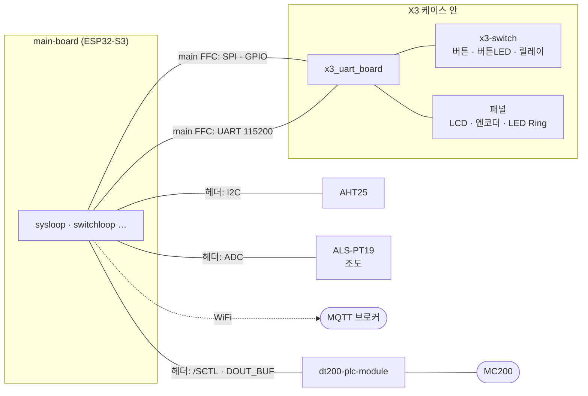

# 아키텍처 — X3 Thermostat 안에서 이 펌웨어의 위치

> 이 저장소는 **main-board rev A의 ESP32-S3-WROOM-1-N16R8** 에 올라가는 펌웨어다.
> 이 문서는 X3 Thermostat 시스템 가운데 **ESP32-S3가 맡는 범위**를 펌웨어 관점으로 정리한 것이다.

## 1. 무엇을 하는가

Tuya X3 노브 스위치의 Zigbee 모듈(ZS3L) 자리에 `x3_uart_board`를 꽂고, 케이스 밖의
main-board(ESP32-S3)가 **벽면 유닛 한 대의 두뇌**가 된다. 한 대가 두 가지 일을 한다.

| 기능 | 경로 | 연동 대상 |
|---|---|---|
| **전등 스위치** | x3-switch 릴레이 (AT) · WiFi → **MQTT** | homebridge-mqttthing |
| **온도조절기** | AHT25 측정 → **PLC 2선** (500 kHz ASK) | MC200 밸브제어기 |

기존 보일러 버스의 조절기 **두 종류를 모두 대체**한다 ([plc-protocol.md](plc-protocol.md) §7).

| 역할 | 대체 대상 | PLC 주소 | 하는 일 |
|---|---|---|---|
| 방 조절기 | 각방 LT200SPD | 방 번호 + 1 | 자기 방 온도 · 모드, 원격 설정(DT-200 · 월패드) 반영 |
| 거실 조절기 | 거실 DT-200 | 1 | 위에 더해 모든 방 상태 보기 · 설정, 온수 온도 설정 |

설치 대상은 방 3개(큰방 · 놀이방 · 일하는방)와 거실이다. 펌웨어는 모두 같고, 유닛마다 다른 점
(역할, 전등 수, 버튼 배정, PLC 주소)은 **설정(NVS)** 으로 흡수한다 → [§5](#5-방별-차이는-설정으로).

> **WiFi가 끊겨도 노브와 버튼으로 난방 · 전등을 로컬 조작할 수 있어야 한다.**
> 전등(MQTT)과 보일러(PLC)는 서로 독립된 경로이고, 로컬 제어는 둘 다에 의존하지 않는다.

## 2. 책임 분할

| 입출력 | 담당 | 경로 |
|---|---|---|
| 원형 LCD 240×240 (GC9A01A) | **ESP32-S3** | main FFC → x3_uart_board → 패널 FFC |
| 로터리 엔코더 (push 없음) | **ESP32-S3** | 〃 |
| LED Ring (red/white) + LCD 백라이트 | **ESP32-S3** | 〃 (한 선을 공유) |
| AHT25 온습도 | **ESP32-S3** | 헤더 I2C |
| 조도 센서 ALS-PT19-315C | **ESP32-S3** | 헤더 ADC (IO1) |
| PLC 모뎀 (dt200-plc-module) | **ESP32-S3** | 헤더 `/SCTL` · `DOUT_BUF` |
| WiFi / MQTT | **ESP32-S3** | |
| 버튼 K1~K4 | x3-switch → AT 통보 | main FFC UART |
| 버튼 LED K1~K4 (bi-color) · LED 레일 | x3-switch ← AT 명령 | 〃 |
| 릴레이 L1~L4 | x3-switch ← AT 명령 | 〃 |

**정책은 전부 ESP32-S3에 있다.** x3-switch 보드는 "키가 눌렸다"를 보고하고
"릴레이를 켜라"를 실행하는 슬레이브일 뿐, 키와 릴레이를 직접 잇지 않는다.
짧게 / 길게 판정도 ESP32-S3(switchloop)가 `+KEY:<ch>,DOWN|UP`으로 한다.



## 3. 소프트웨어 구조

`components/`는 **드라이버**, `main/`은 **loop**다. 드라이버는 이벤트 루프를 모르고
콜백으로만 입력을 알린다. 각 loop는 자기 `sc_eventloop`(esp_event + 타이머)와 상태를 갖고,
드라이버 콜백에서 받은 입력을 자기 루프로 post해서 **루프 스레드 안에서만** 상태를 바꾼다.

```
main/
  main.c · main.h       app_main — config · console · device · x3switch · plc 초기화 → mainloop
  mainloop.c            ✅ get_ver, 각 loop 초기화
  switchloop.c          ✅ x3-switch 보드의 소유자 — 릴레이 · 버튼 LED 상태 동기화, 키 CLICK/LONG 판정
  sysloop.c             🔶 정책의 소유자 — 키 · 엔코더 · AHT25 · 조도 (정책은 TODO)
  uiloop.c              ⬜ 화면 (LVGL 예정)
  plcloop.c             🔶 PLC 프레임 → 그룹 · 메시지(체크섬), 송신 요청 (조절기 역할은 TODO)
  netloop.c             ⬜ WiFi · MQTT
components/
  include/board.h       main-board 핀맵 (유일한 원본, docs/hardware.md와 쌍)
  core/                 ✅ eventloop · console · config(NVS)
  device/               ✅ gc9a01(LCD) · led(Ring+BL) · encoder · als(조도) · temp_humid(온습도, AHT25) · gpio_cmd
  x3switch/             ✅ x3-switch AT 클라이언트 (UART)
  plc/                  ✅ PLC 모뎀 드라이버 — RMT RX 해독 · RMT TX 오픈드레인 송신 (프레임 = 1바이트)
```

✅ = 코드 있음, 🔶 = 골격, ⬜ = 예정. 계획과 순서는 [roadmap.md](roadmap.md).

### 3.1 계층 규칙

| 계층 | 하는 일 | 하지 않는 일 |
|---|---|---|
| 드라이버 (`device` · `x3switch` · `plc`) | 하드웨어 하나를 소유하고 작은 API를 낸다. 입력은 **콜백**으로 알린다 | 이벤트 루프를 알거나, 다른 드라이버를 부르거나, 정책을 판단하지 않는다 |
| loop (`main/*loop.c`) | 자기 상태와 `sc_eventloop`를 소유한다. 콜백 → post → 루프 스레드에서 처리 | 다른 loop의 상태를 직접 바꾸지 않는다 — 그 loop의 API를 부른다 |
| `sysloop` | **정책 상태의 소유자.** 입력을 받아 판단하고 다른 loop에 출력을 요청한다 | 하드웨어를 직접 만지지 않는다 |

loop 파일의 형식은 `scmbd` 프로젝트와 같다 — `_xxxloop_t` 상태 구조체 하나, `static _xxxloop_t *_xxxloop`,
이벤트 · 타이머 id는 파일 안에 정의, `sc_xxxloop_init()` / `sc_xxxloop_end()`, 콘솔 명령은 `_xxxloop_cmd_init()`.

### 3.2 이벤트 흐름

```
[드라이버 콜백]                       [loop 스레드]
x3switch "+KEY" (UART 태스크) ──post──▶ switchloop: DOWN/UP → CLICK/LONG ──콜백──post──▶ sysloop
x3switch "+READY" ────────────post──▶ switchloop: 원하는 상태 전부 재전송
encoder (ISR) ──────post_from_isr──▶ sysloop (밤이면 화면 깨우기)
plc RMT RX (ISR) ──post_from_isr──▶ plcloop: 프레임 → 100 ms 조용하면 그룹 확정 → 메시지 (docs/plc-protocol.md §6)
                        타이머 1 s ──▶ sysloop: 조도 측정 → 밝기 단계 (§3.5)
                        타이머 10 s ─▶ sysloop: AHT25 측정 시작 → 80 ms 타이머 → 읽기

sysloop ──sc_switch_relay_set() 등──▶ switchloop: 값만 기록 → APPLY 이벤트 → AT 전송
```

**예: 사용자가 K3를 짧게 누름**

```
x3-switch "+KEY:3,DOWN" → switchloop: 누름 시작, 1 s 타이머
x3-switch "+KEY:3,UP"   → switchloop: 타이머 전에 뗌 → CLICK → sysloop
    sysloop: 방 설정상 K3 = 전등1 → 토글 (TODO)
      ├─▶ sc_switch_relay_set(1, true)      ─▶ switchloop: AT+RELAY=1,1
      ├─▶ sc_switch_led_set(3, WHITE)       ─▶ switchloop: AT+LED=3,W
      └─▶ netloop: light1/state = ON (예정)
```

**UART를 기다리는 것은 switchloop뿐이다.** sysloop은 setter를 부르고 바로 돌아오므로
x3-switch가 없거나 느려도 센서 · 엔코더 처리가 밀리지 않는다.

### 3.3 x3-switch 링크 (`components/x3switch` + `main/switchloop.c`)

규격은 `x3-switch/docs/at-protocol.md`가 원본이다. ESP32-S3 쪽 구현 요건만 정리한다.

**드라이버 (`x3switch`)** — 규격을 API로 옮긴 것뿐이다.

- UART1, 115200 8N1. 수신 태스크는 UART 이벤트 큐로 깨어나 줄 단위로 자른다 (폴링 없음).
- 명령 하나를 보내고 `OK`/`ERROR`까지를 한 트랜잭션으로 본다. 응답 타임아웃 **100 ms**.
- `+KEY:` · `+READY:` 는 **트랜잭션 도중에도 끼어든다.** 트랜잭션과 섞지 않고 콜백으로 넘긴다.
- 콘솔 `x3switch`(버전 · 보드가 보고하는 전체 상태), `x3switch reset`(`AT+RST`).

**switchloop** — 보드 상태의 소유자.

- 부팅 시 `AT+STATUS?`로 **보드의 현재 상태를 그대로 받아들인다.** ESP32만 재부팅돼도
  켜져 있던 전등이 꺼지지 않게 하기 위해서다.
- setter는 "원하는 상태"만 바꾸고 APPLY 이벤트를 올린다. 루프는 보드가 확인한 상태와
  **다른 항목만** AT로 보낸다.
- `+READY`를 받으면 보드가 기본값으로 돌아간 것 → 원하는 상태를 **전부** 다시 보낸다.
- 타임아웃이 나면 그 회차를 중단하고 2초 뒤 다시 시도한다 (보드가 없을 때 명령마다 100 ms씩
  쌓이지 않게). `AT+RST`로의 자동 복구는 아직 없다. **하드웨어 리셋 선은 없다.**
- 키: DOWN에서 1초 타이머를 걸고, 타이머 전에 UP이면 CLICK, 타이머가 먼저면 LONG(누른 채로 발생).
- 현재 **K4는 누르면 x3-switch 보드가 리셋된다** (x3-switch `hardware.md` §2.1.1). 수리 전까지
  정책에서 K4를 쓰지 않는다.

### 3.4 콘솔

USB Serial/JTAG(IO19 · 20) 위에 `esp_console` REPL이 돈다. 드라이버마다 시험용 명령을
등록해 하드웨어를 손으로 확인할 수 있게 한다 — 새 드라이버도 같은 방식을 따른다.

**loop가 소유한 출력은 loop의 명령으로만 바꾼다.** 릴레이 · 버튼 LED(`relay` · `btn_led` …)는
switchloop에 있다. 드라이버를 직접 부르는 명령을 두면 loop가 가진 상태와 실제 출력이 어긋난다.
명령 목록은 루트 `README.md`.

### 3.5 밝기 자동 조절 — 밤에 방을 밝히지 않기

**목적은 잘 때 LCD · LED가 방을 밝히지 않게 하는 것이다.** 그래서 정밀한 밝기 곡선이 아니라
어두운 쪽을 확실히 가르는 3단계로 한다. 구현은 `main/sysloop.c`의 Brightness 절.

> **임시 사양이다.** LED Ring이 on/off로만 반응하는 것을 전제로 한 출발값이며,
> 실제 구현 단계에서 사양을 다시 정리한다.

| 단계 | 진입 (대략 lux) | 상황 | LCD 백라이트 (0~255) | 버튼 LED | 화면 |
|---|---|---|---:|---:|---|
| **NORMAL** | > 60 | 천장 조명 (보통 100~300 lux) | 255 | 100 % | 켜짐 |
| **DIM** | 30 아래 / 밤에서 8 위 | 스탠드 · 간접등 | 60 | 30 % | 켜짐 |
| **NIGHT** | < 3 | 소등 (커튼 너머 가로등 ~1~5 lux) | 8 | 3 % | **꺼짐** — 노브 · 버튼을 만지면 10 s 켜짐 |

- **경계마다 히스테리시스.** NIGHT는 3 아래로 들어가 8 위로 나온다. DIM ↔ NORMAL은 30 / 60.
- **머무름 시간.** 새 단계가 계속 유지돼야 바꾼다 — 어두워지는 쪽 **20 s**(지나가는 그림자 무시),
  밝아지는 쪽 **3 s**(불을 켜면 바로 반응). 측정은 1 s마다.
- **밤에는 화면을 끈다.** LED Ring은 백라이트와 같은 선이라 밝기를 줄일 수 없고, 백라이트가
  켜져 있으면 Ring도 켜진다. 그래서 NIGHT에서는 백라이트를 끄고(Ring도 꺼짐) 만질 때만 켠다.
- **깨운 화면이 센서를 밝히는 되먹임을 막는다.** NIGHT에서 화면을 깨운 동안은 단계를 올리지
  않는다. 화면이 다시 꺼진 뒤 판단한다.
- 버튼 LED는 `sc_switch_led_brightness()` → switchloop → `AT+LEDBRI`. 단계가 바뀔 때만 보낸다.
  x3-switch 쪽 실측으로 1 %에서도 희미하게 켜지므로 밤 3 %는 보이되 방을 밝히지 않는 수준이다.
- 값은 모두 데이터시트 기준 **대략적인 lux**와 선형 PWM 기준의 출발값이다. 실제 방에서
  `bright` · `sysinfo`로 보며 조정한다. 센서가 없는 책상에서는 `bright normal`로 고정한다.

**남은 것**

- 밤에 노브 첫 칸은 화면만 깨우고 설정 온도는 바꾸지 않기 (TODO)
- 단계 전환 시 백라이트 페이드
- 방마다 다르면 경계값을 NVS 방 설정으로

## 4. 부팅 시퀀스 (목표)

```
전원 인가
  ├─ x3-switch: 수십 ms 안에 릴레이 OFF · LED 주황 → "+READY"
  └─ ESP32: config(NVS) → console → device(LCD · Ring · 엔코더 · 센서) → x3switch
            → mainloop → switchloop (AT+STATUS? 로 보드 상태 채택)
                       → sysloop (센서 타이머 · 키 · 엔코더)
            → plcloop → (예정) 방 설정 로드 · netloop (WiFi 실패해도 로컬 동작 계속)
```

난방 설정(목표 온도, ON/OFF)은 NVS에 두어 정전 뒤에도 복원한다. 전등 상태는
정전 시 OFF가 안전한 기본값이므로 복원 여부를 설정으로 둔다.

## 5. 방별 차이는 설정으로

| 항목 | 큰방 | 놀이방 · 일하는방 |
|---|---|---|
| 전등 | 3 (L1~L3) | 2 (L1 · L2) |
| 버튼 배정 | 미결 — K1 또는 K2를 세 번째 등에 | K3 · K4 = 전등 1 · 2 |
| 역할 · PLC 주소 | 방 조절기, 주소 = DT-200의 방 번호 + 1 (방별 번호는 설치 때 확인) | 〃 (거실 유닛은 거실 조절기, 주소 1) |
| MQTT 토픽 접두사 | 방 이름 | 방 이름 |

**펌웨어 바이너리는 한 개다.** 방 설정은 NVS(`core/config`)에 두고 콘솔로 기록한다 — 명령은 아직 없다 (Phase C).

## 6. 참고 문서

| 문서 | 내용 |
|---|---|
| [hardware.md](hardware.md) | 핀맵 · 모듈 제약 · 패널 신호의 전기적 동작 |
| [roadmap.md](roadmap.md) | 단계별 작업과 미결 사항 |
| [plc-protocol.md](plc-protocol.md) | 보일러 버스 PLC 파형 규칙 · 프레임 포맷 · 구현 |
| `x3-switch/docs/at-protocol.md` | x3-switch AT 명령 규격 (원본) |
